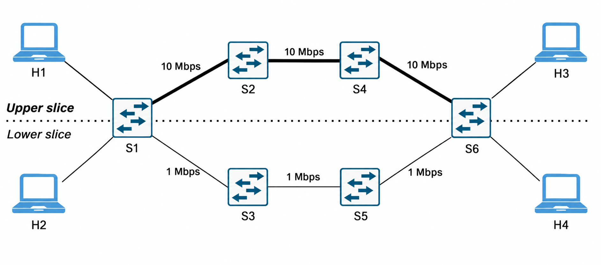

# Network Slicing in SDN con Ryu e Mininet  
### Progetto per il corso – Network and Cloud Infrastructures  
Laurea Magistrale in Ingegneria Informatica — Università degli Studi di Napoli Federico II

Questo repository contiene il progetto sviluppato per il corso di *Network and Cloud Infrastructures*.  
Il lavoro implementa il network slicing statico, service-based e dinamico in un ambiente SDN, utilizzando Mininet come emulatore di rete e Ryu come controller SDN. 
Inoltre, il progetto estende i requisiti di base introducendo una dashboard di monitoraggio in tempo reale e un classificatore di traffico basato su Machine Learning.

---
## Tecnologie Utilizzate
- Python 3
- Ryu SDN Framework (OpenFlow 1.3)
- Mininet
- Open vSwitch (OVS)
- Streamlit (per la dashboard)
- scikit-learn, pandas (per la classificazione ML)
- iperf

---

## Architettura e Topologia di Base
La rete SDN è composta da **4 host** e **6 switch OpenFlow (OVS)** organizzati su due percorsi paralleli:



Una separazione logica garantisce l'isolamento tra le due slice:
- **Upper Slice:** H1 ↔ H3 (10 Mbps)
- **Lower Slice:** H2 ↔ H4 (1 Mbps)

Il controller si occupa di far rispettare l'isolamento, del MAC learning e della modifica dei flussi tramite regole OpenFlow 1.3.

---

## Overview

Oltre allo slicing statico di base, il progetto implementa le seguenti estensioni:

- **1. Dynamic Slicing:** Il controller ottimizza l'uso delle risorse monitorando la banda. Se il traffico video scende sotto una soglia minima (< 0.5 Mbps), il traffico dati viene promosso temporaneamente sull'Upper Slice (Fast Lane a 10 Mbps). Non appena il video riprende, la priorità viene ripristinata e i dati tornano sulla Lower Slice.
- **2. Classificazione Statistica (a livello di Pacchetto):** Invece di affidarsi deterministicamente alla lettura dei numeri di porta (L4), il sistema classifica il traffico analizzando le statistiche a livello di pacchetto (`byte_count` e `packet_count`). Per fare questo in modo dinamico, è stato utilizzato un algoritmo non supervisionato (K-Means) che raggruppa autonomamente il traffico video e il traffico dati.
- **3. Dashboard in Tempo Reale:** Sviluppata in Streamlit, permette di monitorare live le metriche di rete, lo stato corrente delle slice e le performance del classificatore ML. Fornisce inoltre una rappresentazione interattiva della topologia e del traffico.

---
## Prerequisiti

Prima di avviare il progetto, assicurati di avere un ambiente Linux (es. una VM Ubuntu) con i tool necessari installati:

```bash
# Dipendenze di sistema
sudo apt update
sudo apt install mininet openvswitch-switch tshark -y

# Dipendenze Python
pip install ryu streamlit pandas scikit-learn
```

---
## Come Avviare il Progetto

1. **Avvia la topologia Mininet:** `sudo python3 slicing_topo.py`
2. **Avvia il Controller Ryu:** `ryu-manager main_controller.py`
3. **Genera il Traffico (dalla CLI di Mininet):** `source video_traffic.sh` e `source normal_traffic.sh`
4. **Lancia la Dashboard (in un terminale separato):** `streamlit run app.py`

### Testare il Dynamic Slicing con tshark
Per verificare fisicamente i cambi di instradamento sulle interfacce degli switch, puoi monitorare i link dello switch di ingresso (`S1`) aprendo dei terminali separati:
- Upper Slice (10 Mbps): `sudo tshark -i s1-eth3 -f "tcp"`
- Lower Slice (1 Mbps): `sudo tshark -i s1-eth4 -f "tcp"`

**Esecuzione del test:**
1. Avvia il traffico dati: `mininet> source normal_traffic.sh`. I pacchetti scorreranno su `s1-eth4`.
2. Attendi circa 10 secondi. Essendo il traffico video assente, il traffico dati migrerà automaticamente sulla porta più veloce `s1-eth3`.
3. Avvia il traffico video: `mininet> source video_traffic.sh`. Il video prenderà priorità su `s1-eth3` e i dati verranno rimandati istantaneamente su `s1-eth4`.
